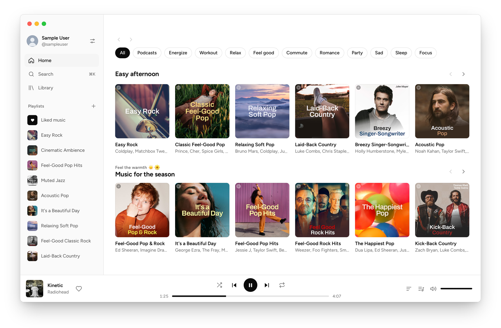
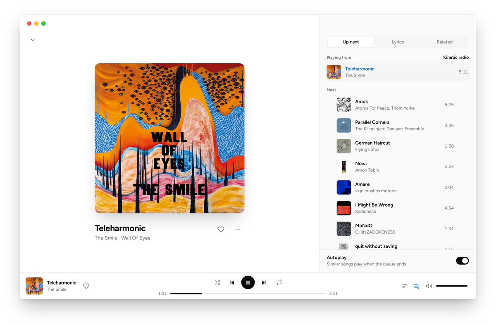
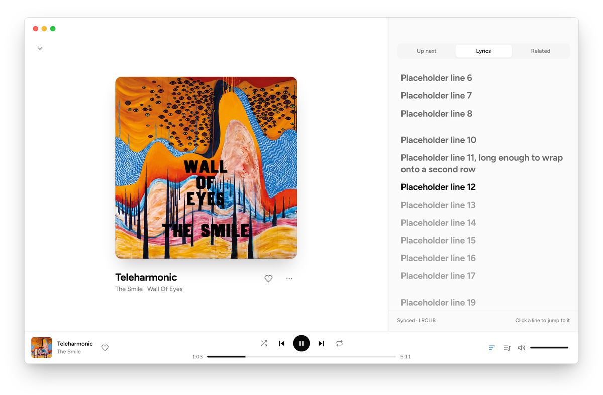
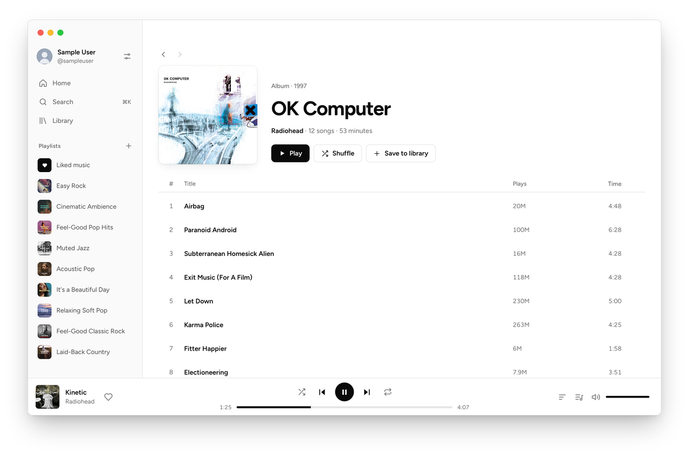
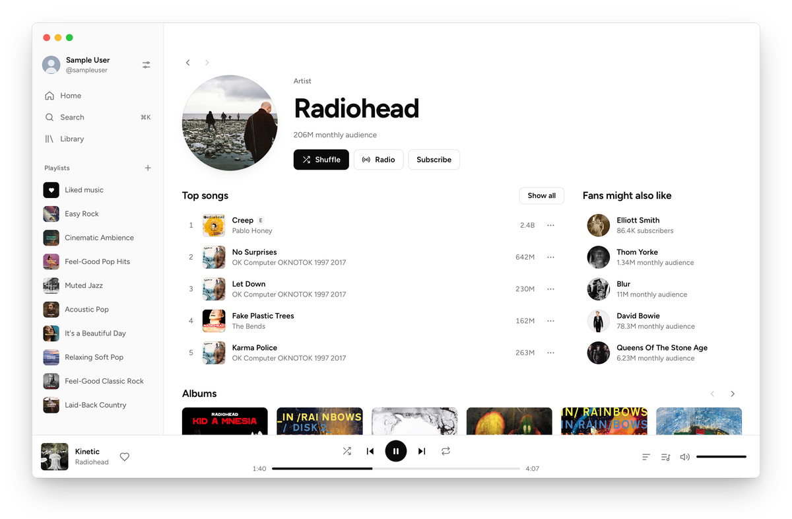
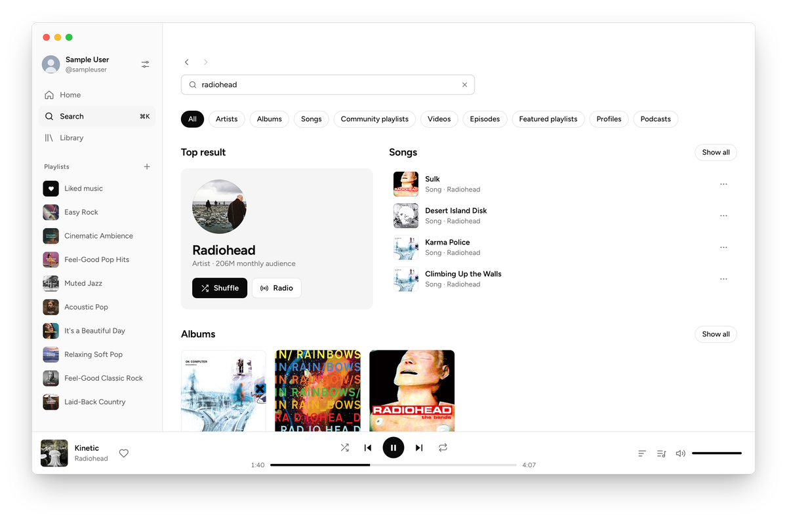
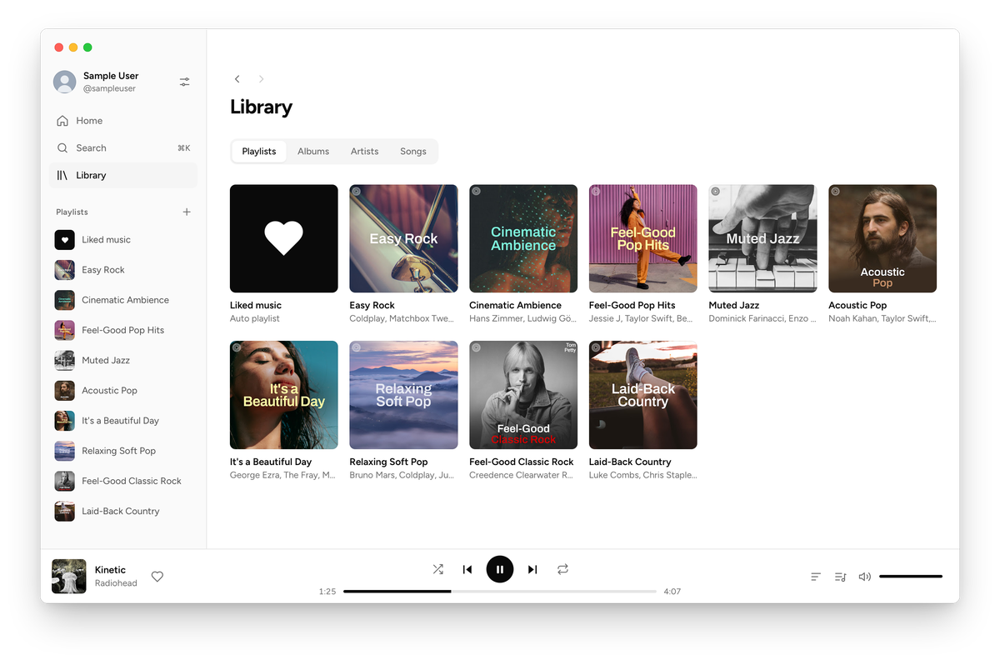
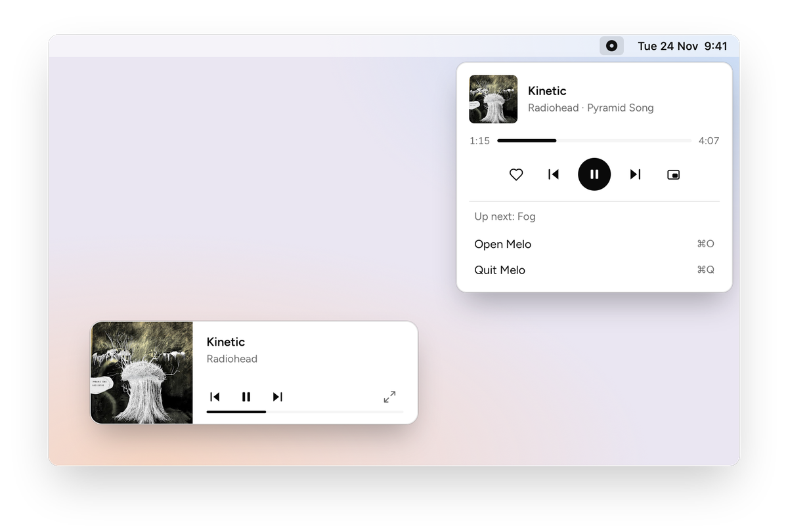
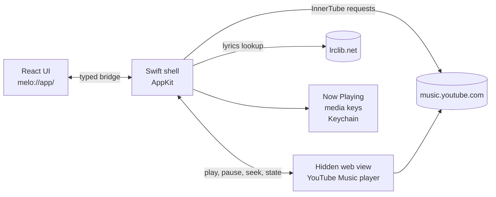

<div align="center">

<h1>Melo</h1>

A YouTube Music client for macOS, with a Swift shell, a React UI and YouTube Music's own player underneath.

<br>


**[Download the latest release](../../releases/latest)**

</div>

<br>

<picture>
  <source media="(prefers-color-scheme: dark)" srcset="assets/screenshots/home-dark.png">
  
</picture>

## Features

- Plays through YouTube Music's own web player, so Premium, your library and your recommendations work as they do on music.youtube.com.
- Home, search with filters and suggestions, albums, playlists, artists, and your library of playlists, albums, artists and songs.
- Melo keeps its own queue: shuffle, repeat, drag to reorder, and radio that carries on when the queue runs out.
  The queue and your place in the song survive a relaunch.
- Synced lyrics from YouTube Music or LRCLIB, whichever has the better match.
- Media keys, AirPods controls and the Now Playing card in Control Center.
- A menu bar panel and a floating mini player.
- Like songs, save albums, build playlists and subscribe to artists.
- Light and dark themes that follow the system or stay where you set them.
- Keyboard first: ⌘K to search, ⌘[ and ⌘] to go back and forward.

## Screenshots

<table>
  <tr>
    <td width="50%">
      <picture>
        <source media="(prefers-color-scheme: dark)" srcset="assets/screenshots/upnext-dark.png">
        
      </picture>
      <p align="center">Now playing, with Up next</p>
    </td>
    <td width="50%">
      <picture>
        <source media="(prefers-color-scheme: dark)" srcset="assets/screenshots/lyrics-dark.png">
        
      </picture>
      <p align="center">Synced lyrics</p>
    </td>
  </tr>
  <tr>
    <td width="50%">
      <picture>
        <source media="(prefers-color-scheme: dark)" srcset="assets/screenshots/album-dark.png">
        
      </picture>
      <p align="center">Album</p>
    </td>
    <td width="50%">
      <picture>
        <source media="(prefers-color-scheme: dark)" srcset="assets/screenshots/artist-dark.png">
        
      </picture>
      <p align="center">Artist</p>
    </td>
  </tr>
  <tr>
    <td width="50%">
      <picture>
        <source media="(prefers-color-scheme: dark)" srcset="assets/screenshots/search-dark.png">
        
      </picture>
      <p align="center">Search</p>
    </td>
    <td width="50%">
      <picture>
        <source media="(prefers-color-scheme: dark)" srcset="assets/screenshots/library-dark.png">
        
      </picture>
      <p align="center">Library</p>
    </td>
  </tr>
  <tr>
    <td colspan="2" align="center">
      <picture>
        <source media="(prefers-color-scheme: dark)" srcset="assets/screenshots/satellites-dark.png">
        
      </picture>
      <p align="center">Menu bar panel and mini player</p>
    </td>
  </tr>
</table>

The screenshots show anonymous YouTube Music data and a made-up account.
The lyrics are placeholder text.

## Install

### Download

1. Download `Melo-<version>.zip` from the [latest release](../../releases/latest).
   It runs on macOS 14 or later, on Apple silicon and Intel.
2. Unzip it and drag Melo to your Applications folder.
3. Open Melo.
   Apple hasn't notarised it, so macOS blocks it the first time.
   Go to System Settings > Privacy & Security and click Open Anyway next to the message about Melo.
   You only do this once.
4. Sign in with your own Google account.
   YouTube Music Premium removes ads, as it does on music.youtube.com.

Each release also carries a `.sha256` file.
To check your download, compare it with the output of `shasum -a 256 Melo-<version>.zip`.

### Build from source

You need:

- macOS 14 or later
- Xcode 16 or later, for Swift 6
- Node 20.19+ or 22.12+, with npm

```bash
scripts/build.sh
```

This builds the UI and a release binary, then assembles `~/Applications/Melo.app`.
The app serves its UI from its own Resources at `melo://app/`, with no local server.
Set `MELO_APP` to put the app somewhere else, `MELO_VERSION` to stamp a version, or `MELO_UNIVERSAL=1` for a build that runs on Apple silicon and Intel.

## Develop

Run the Vite dev server, then point the Swift shell at it:

```bash
cd ui && npm install && npm run dev        # Vite on 127.0.0.1:5173
MELO_DEV_URL=http://127.0.0.1:5173/ swift run Melo
```

You can also open http://127.0.0.1:5173/ in a browser to work on screens without the shell.
In development a stand-in bridge answers from the committed fixtures, and production builds leave it out.

To watch bridge traffic from a running app:

```bash
/usr/bin/log stream --level debug --predicate 'subsystem == "com.charlieadam.melo"'
```

Each request and event logs its name and size, never its contents.

## How it works



- **Playback.**
  A hidden web view loads music.youtube.com and plays the audio, so your Premium account and its ad-free playback carry over.
  An injected script drives the player and reports its state back to Swift.
- **Data.**
  Swift calls InnerTube, YouTube Music's internal API, with your session.
  The UI builds the requests and parses the responses, but only Swift can send them, and only to endpoints on an allowlist.
- **Queue.**
  Melo owns the queue instead of mirroring YouTube Music's, and tells the player what to play next.
  It saves the queue to disk so a relaunch picks up where you left off.
- **UI.**
  React, Vite and TypeScript, styled with plain CSS and design tokens.
  It talks to Swift through one typed bridge declared in `ui/src/bridge/protocol.ts` and mirrored in `Sources/Melo/Protocol.swift`.

## Testing

```bash
swift test
cd ui && npm test && npm run typecheck && npm run lint
```

The unit tests run offline against committed fixtures.

Three self-tests check the app against the live service, print one line per check, and quit:

| Command | Checks |
| --- | --- |
| `MELO_SELFTEST=1 swift run Melo` | InnerTube calls, signed out and, if you're signed in, signed in |
| `MELO_PLAYER_SELFTEST=<videoId>[,<videoId>] swift run Melo` | Playback, seeking and volume in the hidden player |
| `MELO_QUEUE_SELFTEST=1 swift run Melo` | Queue advance, repeat, Previous, and save and restore |

The player and queue self-tests play real tracks.
They mute the player page first and refuse to run if the mute fails.

## Releasing

Push a version tag:

```bash
git tag v0.2.0 && git push origin v0.2.0
```

The release workflow runs the tests, builds a universal `Melo.app` with `scripts/package.sh`, and publishes `Melo-0.2.0.zip` and its `.sha256` as a GitHub release with the notes in `.github/release-notes.md`.
To build the same zip locally, run `scripts/package.sh 0.2.0`, which writes to `build/`.

## Privacy and security

You sign in on Google's own page inside the app, and the app never sees your password.
Your sign-in cookies stay in the app's WebKit data store, with a backup in your login Keychain that never syncs to iCloud.
The React UI never gets them: Swift makes every YouTube Music request and hands back only the response.
Song title, artist and length go to lrclib.net when the app looks up lyrics, unless you turn LRCLIB off in Settings.
Nothing else leaves your Mac except the requests to YouTube Music itself.
Signing out deletes the Keychain backup and the cookies.

[SECURITY.md](SECURITY.md) lists where each piece of data lives and how to report a security problem.

## Project layout

| Path | Contents |
| --- | --- |
| `Sources/Melo/` | The Swift shell: window, bridge, sign-in, InnerTube client, hidden player, queue, Now Playing, lyrics, menu bar and mini player |
| `Sources/Melo/Resources/` | Scripts injected into the hidden player |
| `Tests/MeloTests/` | Swift Testing tests |
| `ui/src/bridge/` | Every bridge message, and the client that sends them |
| `ui/src/api/` | InnerTube request builders and parsers, with scrubbed fixtures |
| `ui/src/screens/`, `ui/src/satellite/` | Screens, and the menu bar and mini player pages |
| `ui/src/styles/tokens.css` | Design tokens for both themes |
| `scripts/` | `build.sh` and `package.sh` |
| `assets/screenshots/` | README screenshots |

## Acknowledgements

[Kaset](https://github.com/sozercan/kaset), an MIT-licensed YouTube Music client for macOS, showed how to sign in, call InnerTube and drive the web player.
This project uses it as a reference, and comments credit it where code follows it closely.

## Disclaimer

Melo is a personal project.
It isn't affiliated with or endorsed by Google or YouTube.
It needs your own YouTube Music account, and it plays music through YouTube Music's own web player under that account.
YouTube, YouTube Music and Google are trademarks of Google LLC.
